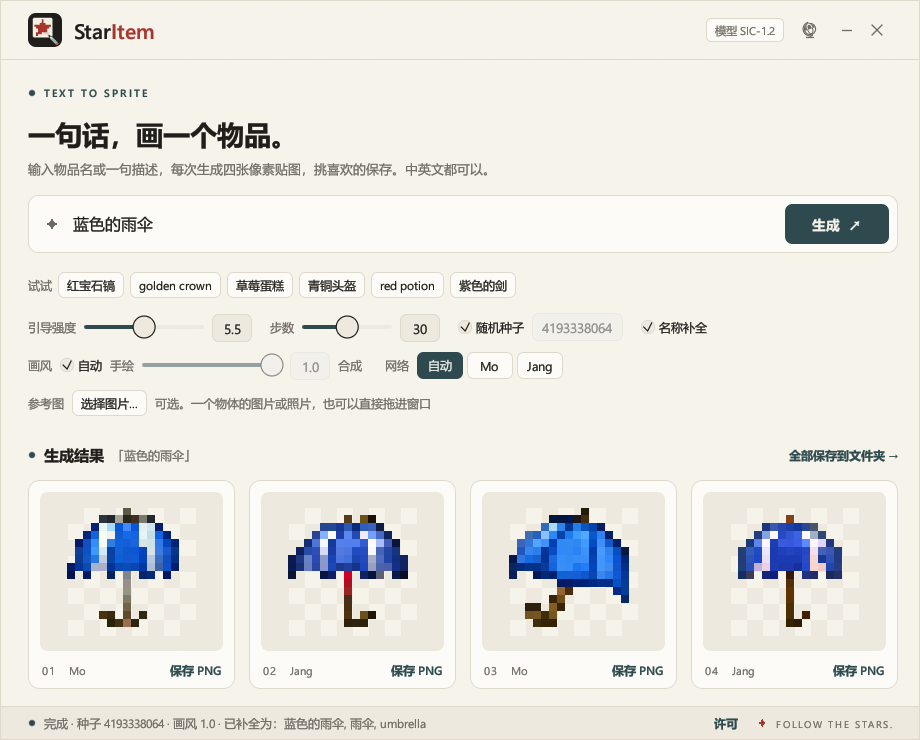

# StarItem

[中文](README.zh.md) | English

Type an item name and get Minecraft-style 16×16 item sprites. Each run produces four images; save the ones you like as PNG.



- A single exe. Double-click to run; no Python and no GPU driver needed, the model is built in.
- Prompts can be Chinese or English: `ruby pickaxe`, `golden crown`, `alarm clock`, `潜水艇`.
- No GPU required. Four images take a few seconds on an ordinary CPU.
- Output is a 16×16 PNG with a transparent background, ready for a resource pack or a mod.

## Usage

1. Download `StarItem_SIC-1.2.exe` (about 605 MB) from the releases page and run it from anywhere. Only Windows x64 is available for now.
2. Type an item name or a short description and click "Generate".
3. Each image has a "Save PNG" button; "Save all to folder" at the top right of the results saves all four.

The interface follows the system language and can be switched with the button in the title bar.

| Option | What it does |
|---|---|
| Guidance | Higher sticks closer to the prompt; lower gives more variety between the images. Default 5.5. |
| Steps | Sampling steps, default 30. More steps are slower and improve little. |
| Random seed | Untick it to enter a fixed seed; the same input then gives the same images. |
| Name completion | Expands common names to the full name the model saw in training, e.g. `alarm clock` becomes `闹钟, alarm clock`. The status bar shows the expanded prompt. |
| Style | "Hand-drawn" leans towards the way mod sprites are drawn, "Synthetic" towards everyday objects. With "Auto" ticked the client picks per item; you rarely need to change it. |
| Network | The model holds two networks, called Mo and Jang. Jang draws items it knows by name accurately; Mo follows color words and new combinations more readily. With "Auto", a prompt that is exactly a name the model knows goes to Jang, and anything else gets two images from each; the label under every image says which one drew it. If one of them suits a prompt better, you can use it alone. |
| Reference | Optional. Choose a picture or photo of the object (PNG or JPG, one object in view), or drop it onto the window, and the sprites follow its shape and colors. A plain or transparent background is removed directly, and in a photo the main object is cut out automatically; the small thumbnail in the Reference row shows what was cut out. You still type the item name. A lower "Freedom" stays closer to the reference, a higher one draws more cleanly; "Keep colors" sets how far the result's colors are pulled towards the reference. |

Prompt tips:

- A plain item name works best. The model is not good at long sentences.
- You can put a color or material before the name: `purple sword`, `golden crown`.
- If the result is poor, click "Generate" a few more times or try another name (`laptop` and `computer` may give different results).
- When you have a picture of the real thing, a reference usually works better than rewording the prompt. Things the model does not recognise by name (the bare Chinese word 望远镜, for example, which could be a spyglass, binoculars or a telescope) often come out right once it has a picture.

## Model: SIC-1.2

| | |
|---|---|
| Type | Pixel-space diffusion model that generates 16×16 RGBA images directly |
| Network | Two UNets: Mo with about 60.7M parameters, Jang with about 64.3M (the difference is one trainable vector per token) |
| Text encoder | [multilingual-e5-small](https://huggingface.co/intfloat/multilingual-e5-small) (frozen, quantized, distributed with the model) |
| Sampling | DDIM, 30 steps by default, classifier-free guidance |
| Format | ONNX, runs on CPU with ONNX Runtime |
| Size | About 570 MB of model files, plus a 4.6 MB matting model |

Both networks are trained on the same data and share the tokenizer, the text encoder and the name-completion table. They differ in the text conditioning: Jang adds a trainable vector per token to the frozen text features, which lets it tell apart items whose names mean similar things, so it knows names far better; the price is that it is less steady than Mo on combinations it has never seen. By our automatic evaluation, the share of everyday items whose typical image is closest to that very item is 34% for Mo and 57% for Jang; with a color word in front of the name, Jang keeps the item better and Mo follows the color better. That is why the client assigns prompts per case and uses both when it cannot tell.

The training set has about 96,000 16×16 sprites:

| Source | Sprites | Notes |
|---|---|---|
| Hand-drawn item sprites from open-source mods | 17,567 | From 200 mods; the asset license of each was reviewed individually |
| Synthetic sprites | 78,346 | Generated with image models from a list of 4,046 everyday items, then filtered |

Full sources, authors and licenses are in [DATA_SOURCES.md](DATA_SOURCES.md) (in Chinese; a machine-readable version is in [docs/data_sources.csv](docs/data_sources.csv)).

## For AI assistants

The model files are also released on their own (`manifest.json`, `unet.onnx`, `unet_names.onnx`, `text_encoder.onnx`, `tokenizer.json`, `aliases.json`, `known_names.json`, `coverage.json`), so the model can be used without the client. `unet.onnx` is Mo and `unet_names.onnx` is Jang; an older client that only knows one network uses Mo when given this package.

`skill/staritem-sprites/` is a skill for text-based AI assistants: the assistant calls the model with an item name, looks at the preview to pick a sprite, and puts it into your mod's folder. It is one instruction file plus one standalone Python script that needs `onnxruntime`, `numpy` and `tokenizers`. The script can also draw from a reference picture or photo (`--ref image`; needs `pillow` as well).

The script also works directly from the command line:

```bash
python skill/staritem-sprites/scripts/generate.py "alarm clock" "ruby pickaxe" --models <model folder> --out sprites
```

## Known limitations

- Only 16×16 sprites.
- Items that are common in mods (tools, weapons, ingots, potions, food) are the most reliable. Of the 4,046 everyday items, roughly three quarters come out reliably by our automatic evaluation; the rest may only come out as "something of that kind".
- Complex or thin objects are hard to show at 16×16 in the first place, for example cameras, spinning wheels and jigsaws.
- A material-plus-item combination nobody drew before is a draw: Jang gets the colors right but tends to add a stray block of color to staffs and wands with unusual materials; Mo keeps shapes steadier but often gets the color wrong. That is what two images from each are for.
- The model does not understand complex descriptions such as "a blue shield with a star on the left".
- Photos are cut out by a small model that looks for the main object. It works well when one object clearly stands out; with several things in view, or an object that fills the whole frame, it can pick the wrong thing or find nothing. Crop the picture to that one object and try again.
- Logos, text and other fine detail do not survive in 16×16, with or without a reference.
- A generated sprite may resemble one from the training set. Use your own judgement before publishing work that includes it.

## License

- **Code**: [MIT License](LICENSE).
- **Matting model**: reference photos are cut out with U²-Net-p, under the [Apache License 2.0](licenses/Apache-2.0.txt) and distributed unmodified; the full text can be read in the client under "Licenses" in the status bar.
- **Model weights**: [CC BY-NC-SA 4.0](LICENSE-MODEL.md). The training data includes assets under CC BY-NC and CC BY-NC-SA licenses, so the weights are for non-commercial use only. The released exe has the weights built in, so the exe as a whole is also for non-commercial use only.
- Sources and attribution are in [DATA_SOURCES.md](DATA_SOURCES.md). If you are the author of one of these mods and want your assets removed, please open an issue.
- This project is not an official Minecraft product. It is not affiliated with, or approved by, Mojang or Microsoft. Mo and Jang are just nicknames for the two networks.

## Building from source

The client lives in `client/` and is written in Rust (egui + ONNX Runtime):

```bash
cd client
cargo build --release
```

Model files go in `client/models/` and are embedded into the exe at build time. You can also point the program at another set of model files at run time with `--models <dir>`.

## Training pipeline

Training is done in Python. The scripts are in three groups:

| Folder | Contents |
|---|---|
| `tools/` | License review of mod assets, download, extraction, cleaning and labeling |
| `synth/` | Synthetic sprites: training the style LoRA, generating from the item list, filtering, importing outside drafts and redrawing them |
| `train/` | Training the diffusion model, evaluation, ONNX export |

Roughly:

```bash
# 1. Prepare the hand-drawn sprites
python -X utf8 tools/extract_assets.py
python -X utf8 tools/clean_and_label.py

# 2. Synthetic sprites
python -X utf8 synth/train_lora.py --steps 6000
python -X utf8 synth/generate_lora.py --per 20
python -X utf8 synth/build_dataset.py --raw dataset/many_raw --out dataset/many --direct --all-concepts --max-rank 300

# 3. Train and export
python -X utf8 train/train.py --name sic16 --ch 128 --extra dataset/synth2 dataset/many dataset/manual --steps 150000
python -X utf8 train/train.py --name sic17 --ch 128 --extra dataset/synth2 dataset/many dataset/manual --steps 150000 --tok-emb --cap-aug-synth 0
python -X utf8 train/export_onnx.py --run sic16 --names-run sic17 --name SIC-1.2
```

The docstring at the top of each script has the full options and usage.

## Acknowledgements

Thanks to all the mod authors who release their assets under open licenses. They are listed in [DATA_SOURCES.md](DATA_SOURCES.md).
